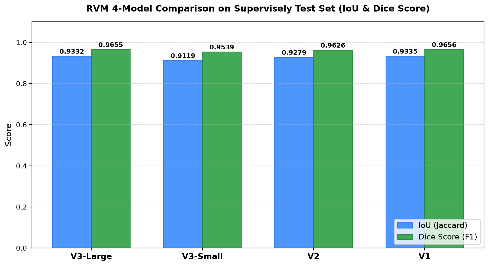
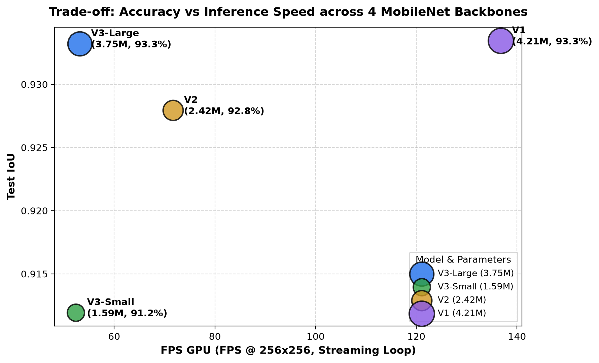
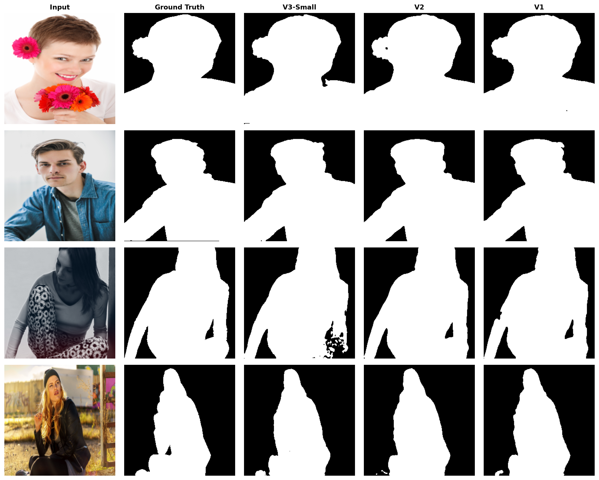

# Human Filter for Video — Real-Time Background Matting for Edge Computing

[](https://pytorch.org/)
[](https://www.python.org/)
[](LICENSE)
[]()

โครงการวิจัยและพัฒนาโมเดลตัดพื้นหลังคนแบบเรียลไทม์ (**Human Matting & Video Filter**) โดยนำสถาปัตยกรรม **Robust Video Matting (RVM)** มาดัดแปลงและทดลองเปลี่ยน Encoder Backbone เป็นตระกูล **MobileNet (V3-Large, V3-Small, V2, V1)** เพื่อเปรียบเทียบประสิทธิภาพ ความแม่นยำ (IoU, Dice Score) และความเร็วในการประมวลผล (FPS, Latency) สำหรับการนำไปใช้งานบนอุปกรณ์ **Edge Computing / IoT / Live Streaming**

---

## สรุปผลการทดลอง

โครงการทดลอง RVM กับ MobileNetV3-Large, MobileNetV3-Small, MobileNetV2 และ MobileNetV1 รวมถึง structural compression, precision conversion และ fine-tune ด้วย Gaussian blur/noise. รายการทุกรุ่นและทุกรอบทดลอง ผลที่วัดได้ และข้อจำกัดของแต่ละ split รวมไว้ใน [รายงานผลการทดลองฉบับรวม](compression/EXPERIMENT_RESULTS.md).

---

## 📈 แผนภาพผลลัพธ์การทดลอง (Visual Evaluation)

### 1. กราฟความแม่นยำเปรียบเทียบทุกโมเดล (IoU & Dice Score)


### 2. แผนภาพ Trade-off: Accuracy vs Inference Speed

*(ขนาดวงกลมแทนจำนวนพารามิเตอร์ของโมเดล ยิ่งอยู่มุมบนขวายิ่งเร็วและแม่นยำ)*

### 3. การเปรียบเทียบเชิงคุณภาพกับ Ground Truth (Qualitative Comparison)


---

## 🛠️ โครงสร้างโปรเจกต์และการใช้งาน

### Preprocessing สำหรับ Fine-tuning

ในโน้ตบุ๊ก fine-tune ทั้ง 4 รุ่น ภาพ train จะถูก resize ก่อน แล้วสุ่มทำ Gaussian blur (โอกาส 25%, radius 0.3–1.2) และ Gaussian noise (โอกาส 35%, standard deviation 0.01–0.05 บนช่วงพิกเซล 0–1) โดยแต่ละ augmentation สุ่มแยกกันและอาจเกิดพร้อมกันได้ ใช้กับภาพเท่านั้น ไม่เปลี่ยน mask; validation และ test ใช้ภาพเดิมโดยไม่เพิ่ม noise/blur ส่วน horizontal flip ยังคงทำงานเหมือนเดิม

การเปลี่ยนนี้มีผลเมื่อรัน fine-tuning ใหม่ checkpoint และตัวเลขผลเดิมใน `outputs/` ยังมาจากการฝึกก่อนเพิ่ม augmentation

```text
Human-filter-for-video/
├── data/
│   └── supervisely/              # Supervisely Person Dataset (2,667 images & masks)
├── notebooks/
│   ├── rvm_finetune.ipynb                   # โน้ตบุ๊กต้นฉบับ RVM MobileNetV3 (Large)
│   ├── rvm_mobilenetv3_small_finetune.ipynb # โน้ตบุ๊ก RVM MobileNetV3-Small (66 เซลล์)
│   ├── rvm_mobilenetv2_finetune.ipynb       # โน้ตบุ๊ก RVM MobileNetV2 (66 เซลล์)
│   ├── rvm_mobilenetv1_finetune.ipynb       # โน้ตบุ๊ก RVM MobileNetV1 (66 เซลล์)
│   └── rvm_backbone_comparison.ipynb        # โน้ตบุ๊กประมวลผลและเปรียบเทียบทุกโมเดล
├── outputs/
│   ├── checkpoints/              # Checkpoint โมเดล (.pth) และ TorchScript (.torchscript)
│   ├── figures/                  # กราฟและรูปผลลัพธ์ทั้งหมด
│   └── results/                  # ตารางสถิติและประวัติการเทรน (.csv)
├── app.py                        # Streamlit Web Dashboard เปรียบเทียบแบบ Interactive
├── compare_webcam.py             # OpenCV Real-Time Webcam (เทียบทุกโมเดลในจอเดียว + Ground Truth)
├── rvm_backbones.py              # โมดูลสถาปัตยกรรม RVM Encoders รองรับ V3-Small, V2, V1
└── requirements.txt              # รายการ Dependencies
```

---

## 💻 วิธีการรันแอปพลิเคชันเปรียบเทียบ (Interactive Comparison)

### 1. หน้าต่าง OpenCV Real-Time Webcam (60 FPS พร้อม Ground Truth ในจอเดียว)
เปรียบเทียบทุกโมเดลแบบสดๆ ผ่านกล้องเว็บแคม พร้อมพาเนล **Ground Truth Reference** และตารางคะแนน Live IoU / FPS:
```powershell
python compare_webcam.py
```
* **ปุ่มลัด (Hotkeys)**:
  * `m` : สลับเอฟเฟกต์พื้นหลัง (Green Screen, หน้ากากขาว-ดำ, เบลอพื้นหลัง, Cutout สีดำ, Cyberpunk Neon)
  * `g` : สลับการจัดวางหน้าจอ (ตาราง 2x3 Grid หรือ แถว 1x5 Strip)
  * `q` : ออกจากโปรแกรม

### 2. เว็บแดชบอร์ด Streamlit (Web Application)
เปิด Web UI สำหรับทดสอบรูปภาพ, วิดีโอ, ชุดข้อมูล Supervisely และ Live Webcam:
```powershell
streamlit run app.py
```

### 3. เว็บแอปเปรียบเทียบ Compression Models
เปรียบเทียบ checkpoint และไฟล์ export ทุกตัวที่อยู่ใน `compression/outputs` ด้วยภาพหรือวิดีโอ:
```powershell
streamlit run compression_app.py
```
เลือกใช้ CUDA สำหรับ PyTorch models ได้ ส่วน ONNX จะรันผ่าน CPU Execution Provider และใช้ recurrent states ต่อเนื่องในวิดีโอ

### 4. การรันโน้ตบุ๊กทดลอง (Jupyter Notebooks)
สามารถเปิดไฟล์โน้ตบุ๊กในโฟลเดอร์ `notebooks/` ด้วย VSCode แล้วกด **Run All** เพื่อรันขั้นตอนตั้งแต่การเตรียมข้อมูล, การเทรน, การประเมินผล, การวาดกราฟ ไปจนถึงการ Export เป็น TorchScript:
* [rvm_mobilenetv3_small_finetune.ipynb](notebooks/rvm_mobilenetv3_small_finetune.ipynb)
* [rvm_mobilenetv2_finetune.ipynb](notebooks/rvm_mobilenetv2_finetune.ipynb)
* [rvm_mobilenetv1_finetune.ipynb](notebooks/rvm_mobilenetv1_finetune.ipynb)
* [rvm_backbone_comparison.ipynb](notebooks/rvm_backbone_comparison.ipynb)

---

## 📦 สรุปคำแนะนำสำหรับการนำไปติดตั้งใช้งานจริง (Deployment Recommendation)

ผลเปรียบเทียบและข้อเสนอแนะจากการทดลองแต่ละ backbone/compression อยู่ใน [รายงานรวมผลการทดลอง](compression/EXPERIMENT_RESULTS.md). ควรวัดซ้ำบนอุปกรณ์และ runtime เป้าหมายก่อนเลือกโมเดลสำหรับ production.
